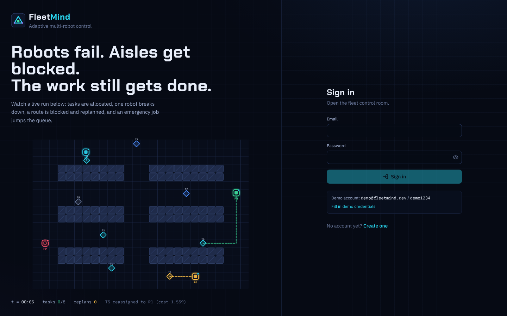
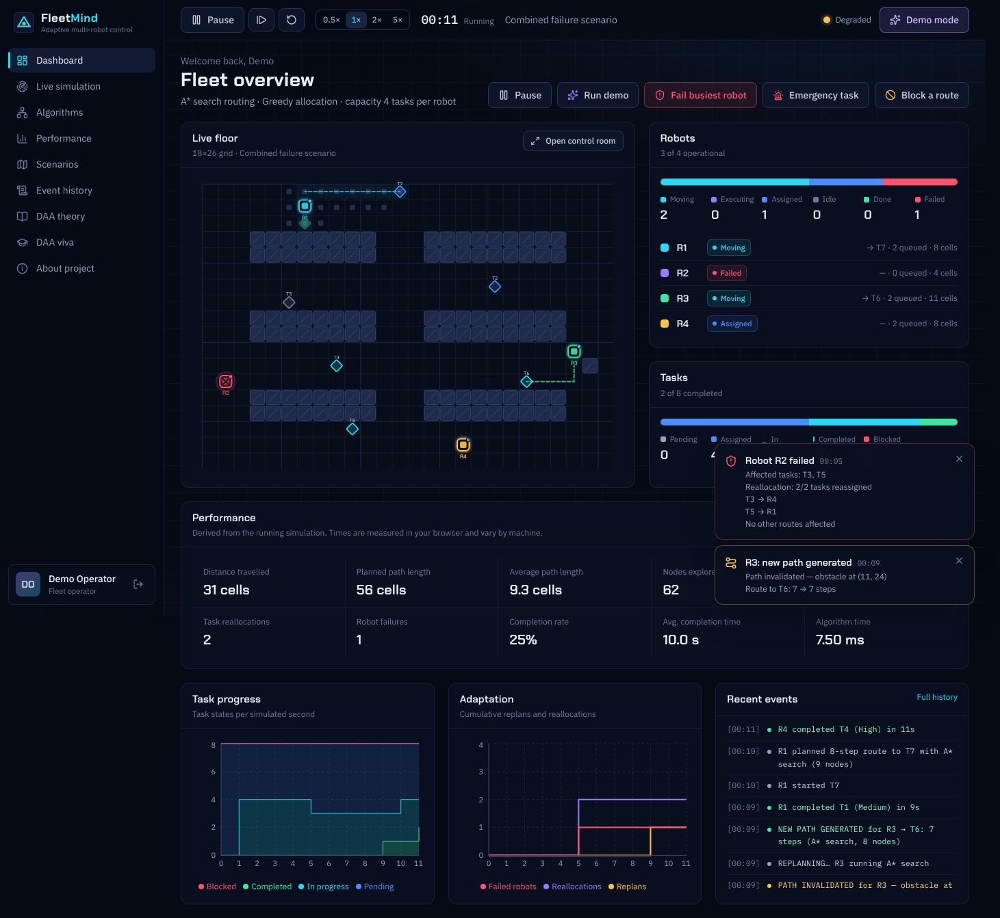
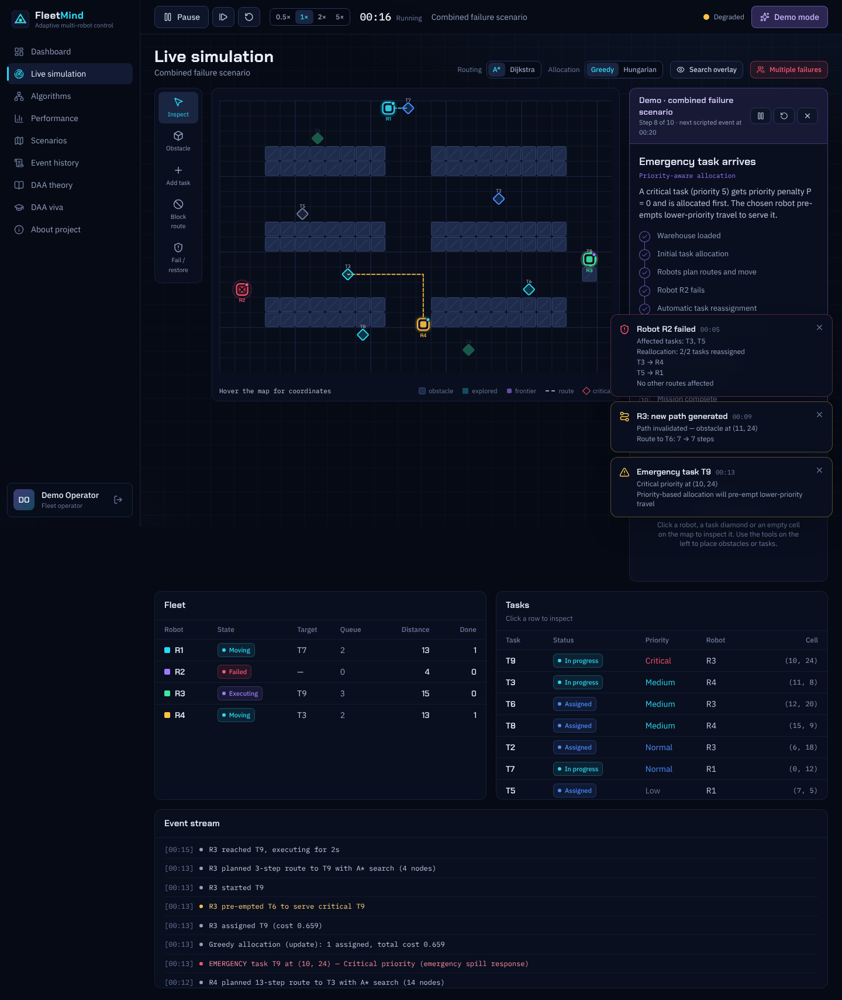
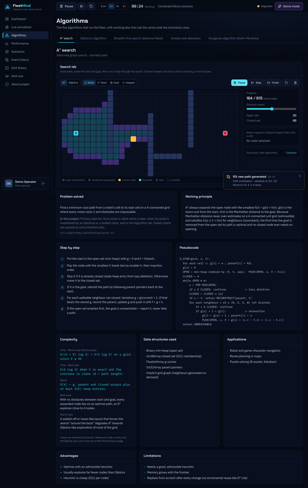
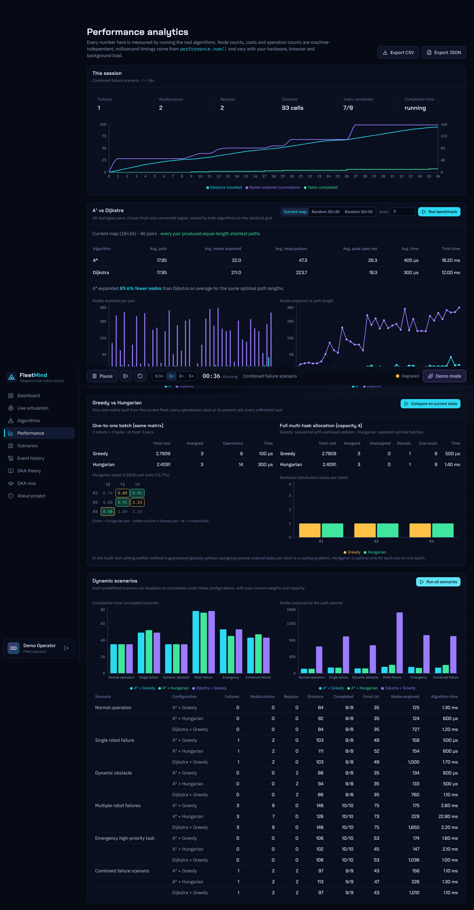
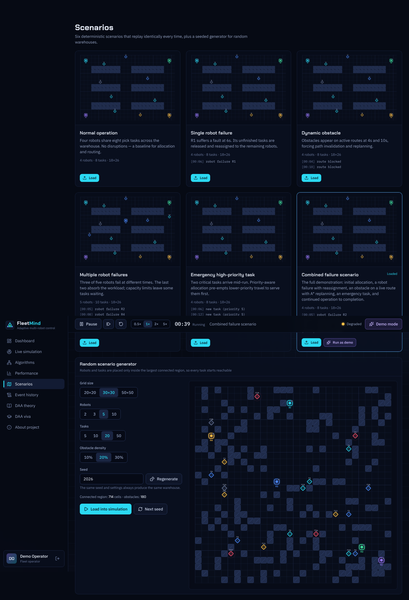

# FleetMind: Adaptive Multi-Robot Task Allocation and Path Planning Under Dynamic Failures

**Course:** Design and Analysis of Algorithms (DAA)
**Type:** Software-only algorithm simulation (no hardware, no backend, no API keys)

FleetMind simulates a fleet of autonomous robots on a 2-D warehouse grid. Robots receive tasks, plan shortest routes, do the work, and adapt when robots break down, aisles get blocked or emergency jobs arrive. Every behaviour comes from real implementations of **A\***, **Dijkstra**, **BFS**, **Greedy allocation** and the **Hungarian algorithm**. The app itself uses plain industry language instead: see *Interface names* below. They run inside a deterministic, tick-based engine that is fully separate from the React UI.

---

## 1. Problem statement

R robots share a grid floor with obstacles. T tasks appear at cells over time, each with a priority (1–5) and an execution duration. At any moment a robot may fail or an obstacle may block a route. The system must keep deciding:

1. **Which robot serves which task** (an assignment problem with capacity, priority and reachability constraints).
2. **How each robot reaches its task** (a shortest-path problem on a changing graph).

It must also recover automatically without losing or duplicating tasks.

## Interface names

The web app avoids algorithm jargon. This is how its labels map to the implementation:

| In the app | Technical name | Source |
|---|---|---|
| Targeted routing | A* search (Manhattan heuristic) | `src/algorithms/pathfinding/astar.ts` |
| Exhaustive routing | Dijkstra's algorithm | `src/algorithms/pathfinding/dijkstra.ts` |
| Quick dispatch | Greedy allocation | `src/algorithms/allocation/greedy.ts` |
| Optimized dispatch | Hungarian algorithm (repeated batches) | `src/algorithms/allocation/hungarian.ts` |
| Score / "What matters when assigning" | Cost function αD + βW + γP + δL | `src/algorithms/allocation/costFunction.ts` |
| Cells searched | Nodes expanded | search result `nodesExplored` |
| Reroute | Dynamic replanning | `src/simulation/ReplanningManager.ts` |
| Reassignment | Task reallocation | `src/simulation/FailureManager.ts` |
| Breakdown | Robot failure (state FAILED) | `src/simulation/FailureManager.ts` |
| Unreachable | Task state BLOCKED | `src/models/Task.ts` |

The DAA theory and viva material is kept in `docs/` (`ALGORITHM_ANALYSIS.md`, `VIVA_QUESTIONS.md`) and is not part of the app.

## 2. Objectives

- Optimal, obstacle-free routes (A* with an admissible and consistent heuristic).
- Low total assignment cost: `Cost(R,T) = αD + βW + γP + δL`.
- Priority-aware allocation, including pre-emption by critical tasks.
- Automatic failure recovery: release the failed robot's tasks, reallocate them, and replan affected routes.
- Measurable, reproducible behaviour: every metric is derived from engine state, and every run is deterministic.

## 3. Features

| Area | What you get |
|---|---|
| **Login** | Register, sign in and sign out. Passwords are hashed with PBKDF2-SHA-256 (120 000 iterations, random salt) via Web Crypto. Sessions last 12 h. All app pages sit behind protected routes. Demo account: `demo@fleetmind.dev` / `demo1234` |
| **Dashboard** | Robot and task state breakdowns, 10 live performance metrics, live mini-map, charts, recent events, a health indicator and quick actions (start/pause, demo, fail busiest robot, emergency task, block a route) |
| **Live simulation** | Interactive SVG floor map. Tools: inspect, place/remove obstacle, add task (priority 1–5), block a robot's route, fail/restore a robot, and multiple simultaneous failures. Also: A*/Dijkstra and Greedy/Hungarian switches, live cost-weight sliders, capacity, search-overlay toggle, robot/task inspectors with cost breakdown and task history |
| **How it works** | Plain-language explanations of route planning, task dispatch and disruption handling. **Route explorer**: draw walls and step through a search, inspecting the distance estimates of any cell. **Dispatch lab**: an editable score table that runs both dispatch methods side by side |
| **Performance** | A* vs Dijkstra on 40 identical start/goal pairs; Greedy vs Hungarian on one shared cost matrix; all 6 scenarios × 3 configurations run headless. Bar and line charts, tables, and CSV/JSON export |
| **Scenarios** | 6 deterministic scenarios with previews, plus a seeded random generator (20/30/50 grid, 2/3/5/10 robots, 5/10/20/50 tasks, 10/20/30 % obstacles) that guarantees reachability |
| **Demo mode** | One click runs the combined failure scenario with a narrated, step-by-step timeline. Each step lights up only when the engine state proves it happened. Pause, resume and restart are supported |
| **Event history** | Full log with timestamps, type, severity, robot and task. Filters, search, CSV export, and a clear button with confirmation |

## 4. Technology stack

React 19 · TypeScript · Vite · Tailwind CSS · Framer Motion · Lucide React · Recharts · React Router · Vitest · React Testing Library · Web Crypto API.

A backend was deliberately **not** added. The algorithms and simulation run in the browser, so a server would add setup cost without adding capability. `AuthService` is an interface, so an Express/JWT implementation can replace `localAuthService` without touching any page.

## 5. System architecture

```
┌────────────────────────── UI (React pages + components) ──────────────────────────┐
│  Dashboard · Simulation · Algorithms · Performance · Scenarios · Events · ...      │
└───────────────▲───────────────────────────────────────────────┬────────────────────┘
                │ useSyncExternalStore (re-render on version)   │ commands (failRobot,
                │                                               │ addObstacle, step ...)
┌───────────────┴──────────── SimulationContext / AuthContext ──▼────────────────────┐
├─────────────────────────────── Simulation engine ───────────────────────────────────┤
│ SimulationEngine (tick loop) · SimulationClock (speed/pause) · DemoController      │
│ AllocationManager · TaskManager · RobotManager · ReplanningManager · FailureManager│
│ stateMachine (transition tables) · invariants · scenarios · ScenarioGenerator       │
├──────────────────────────────────── Algorithms ─────────────────────────────────────┤
│ priorityQueue (MinHeap) · astar · dijkstra · bfs · heuristics                       │
│ costFunction · greedy · hungarian                                                   │
├────────────────────────────────────── Models ───────────────────────────────────────┤
│ Grid · Robot · Task · Event · SimulationState                                      │
└─────────────────────────────────────────────────────────────────────────────────────┘
```

The engine is authoritative. Robot animation is a CSS transform that interpolates between engine positions, so it can never move a robot by itself.

## 6. Folder structure

```
src/
  algorithms/
    pathfinding/  astar.ts  dijkstra.ts  bfs.ts  priorityQueue.ts  heuristics.ts  common.ts  types.ts  index.ts
    allocation/   greedy.ts  hungarian.ts  costFunction.ts  types.ts  index.ts
  simulation/     SimulationEngine.ts  SimulationClock.ts  RobotManager.ts  TaskManager.ts
                  FailureManager.ts  ReplanningManager.ts  AllocationManager.ts  stateMachine.ts
                  invariants.ts  metrics.ts  scenarios.ts  ScenarioGenerator.ts  DemoController.ts  context.ts
  models/         Grid.ts  Robot.ts  Task.ts  Event.ts  SimulationState.ts
  components/     layout/  dashboard/  simulation/  analytics/  charts/  common/  auth/
  pages/          Login  Register  Dashboard  Simulation  Algorithms ("How it works")  Performance
                  Scenarios  EventHistory  About
  context/        AuthContext.tsx  SimulationContext.tsx
  services/       authService.ts  benchmarks.ts
  data/           algorithmDocs.ts (plain-language method descriptions)
  utils/labels.ts plain-language names for states and events
  utils/          format.ts  random.ts
tests/
  algorithms/  allocation/  simulation/  scenarios/  ui/
docs/
  SYSTEM_ARCHITECTURE.md  ALGORITHM_ANALYSIS.md  SIMULATION_WORKFLOW.md
  TESTING_REPORT.md  VIVA_QUESTIONS.md  PROJECT_DEMONSTRATION.md
```

## 7. Algorithms implemented

### A* (primary planner): `src/algorithms/pathfinding/astar.ts`
`f(n) = g(n) + h(n)`, with h = Manhattan distance (admissible and consistent on a 4-connected unit grid). The open set is a binary min-heap ordered by (f, h, insertion order). The closed set is a `Uint8Array`, with parent pointers for reconstruction and lazy deletion instead of decrease-key.

```
OPEN ← {s}; g[s] ← 0
while OPEN ≠ ∅:
    u ← pop-min(OPEN); if u closed: continue; close u
    if u = t: return reconstruct(t)
    for v in neighbours(u): if g[u]+1 < g[v]: g[v] ← g[u]+1; parent[v] ← u; push(v, g[v]+h(v))
return UNREACHABLE
```

### Dijkstra: `dijkstra.ts`
An independent implementation with a min-priority queue and early exit at the goal. It equals A* with h = 0.

### BFS distance fields: `bfs.ts`
One O(V) pass per robot gives exact distances to every task. These are used for the cost function's D term and for the generator's connectivity check.

### Cost function: `costFunction.ts`
```
Cost(R,T) = α·D/(rows+cols) + β·W/capacity + γ·(5 − priority)/4 + δ·L/(2·(rows+cols))
D = BFS distance from robot anchor   W = tasks already queued
L = backlog + D + duration           defaults α=1, β=0.6, γ=0.8, δ=0.4
```

### Greedy allocation: `greedy.ts`
Sort tasks by priority. Each task goes to the cheapest robot that has spare capacity and can reach it; ties go to the lower workload, then the lower id. The robot's workload, backlog and anchor are updated after each assignment.

### Hungarian algorithm: `hungarian.ts`
The O(n³) potentials / shortest-augmenting-path form. Rectangular matrices are padded with zero-cost dummy rows or columns, and infeasible pairs get a large cost and are discarded. **Multiple tasks per robot** are handled by *repeated batches*: each batch is an optimal one-to-one assignment for the current robot anchors and workloads. The batches together are **not** claimed to be globally optimal, because ordered multi-task scheduling is NP-hard.

## 8. Data structures

| Structure | Where | Why |
|---|---|---|
| Binary min-heap | A*, Dijkstra open sets | O(log n) push/pop |
| Implicit graph over `Uint8Array` grid | `models/Grid.ts` | O(1) obstacle test, no stored adjacency |
| `Float64Array` / `Int32Array` / `Uint8Array` | g-scores, parents, closed sets, BFS fields | Compact O(V) arrays |
| `Map<cell, Int32Array>` | `DistanceOracle` | Caches one BFS field per anchor |
| `Set<number>` | failed-robot cells, search overlay, filters | O(1) membership |
| FIFO queue (typed array + head index) | BFS, connected components | O(1) enqueue/dequeue |
| 2-D cost matrix | Hungarian | Assignment input |
| Transition tables (`Record<State, State[]>`) | `models/Robot.ts`, `models/Task.ts` | Enforce legal state changes |

## 9. Complexity

| Algorithm | Time | Space |
|---|---|---|
| Min-heap push/pop | O(log n) | O(n) |
| A* (binary heap) | O((V+E) log V) = O(V log V) on the grid | O(V) |
| Dijkstra (binary heap) | O((V+E) log V) | O(V) |
| BFS | O(V+E) | O(V) |
| Greedy allocation | O(T log T + T·R + A·V), A ≤ R+T BFS anchors | O(A·V) |
| Hungarian (one batch) | O(N³), N = max(R,T) | O(N²) |
| Hungarian (k batches) | O(k·N³ + k·R·T + A·V) | O(N² + A·V) |

Measured node counts and timings are on the **Performance** page. Theoretical bounds and observed timings are reported separately, and timings vary by machine.

## 10. Installation and running

Requires **Node.js 20+** (tested on Node 22).

```bash
cd robot-fleet
npm install          # install dependencies
npm run dev          # start the dev server → http://localhost:5173
npm test             # run all 99 automated tests
npm run typecheck    # TypeScript check (app + tests)
npm run build        # production build into dist/
npm run preview      # serve the production build → http://localhost:4173
```

On Windows (Git Bash, PowerShell or CMD) the commands are identical. No database or environment variables are needed.

## 11. Using the app

1. Open the app and click **Fill in demo credentials**, then **Sign in**. You can also create your own account.
2. Use the top bar on every page: **Start / Pause / Resume**, **Single step**, **Reset**, speed **0.5× / 1× / 2× / 5×**, simulated clock, health indicator and **Demo mode**.
3. On **Live simulation**, choose a tool on the left and click the map:
   - *Inspect*: select a robot, task or cell.
   - *Obstacle*: add or remove an obstacle. If it lands on an active route, that robot replans immediately.
   - *Add task*: choose a priority (5 = critical) and click a free cell.
   - *Block route*: click a moving robot.
   - *Breakdown*: click a robot to break it down or repair it.
   - **Multiple breakdowns** (top right) breaks down several robots at the same moment.
4. Switch **Routing: Targeted / Exhaustive** and **Dispatch: Quick / Optimized** at any time. The next route or assignment uses the new choice.
5. **Scenarios** loads any predefined or random scenario. Random scenarios are reproducible from their seed.

## 12. Scenarios

| Scenario | Events |
|---|---|
| Normal operation | none (baseline) |
| Single robot failure | R1 fails at 6 s |
| Dynamic obstacle | route blocked at 4 s and 10 s |
| Multiple robot failures | R2 at 5 s, R4 at 8 s, R1 at 14 s (5 robots, 10 tasks) |
| Emergency high-priority task | critical tasks at 6 s and 12 s |
| **Combined failure** | R2 fails at 5 s · route blocked at 9 s · emergency task at 13 s · route blocked at 20 s |

## 13. Demo mode (for the presentation)

Click **Demo mode** in the top bar. The combined scenario loads with targeted (A*) routing and the simulation starts at 1×. A narrated timeline on the right steps through 10 stages: warehouse loaded → initial allocation → routes and movement → R2 fails → automatic reassignment → obstacle on a live route → A* replanning → emergency task → emergency handled → mission complete. Notifications show the failure-recovery summary (affected tasks, reallocation status, new assignments, replanning) and every *Route blocked / Rerouting / New route found* event. Use the demo panel to pause, restart or exit. See `docs/PROJECT_DEMONSTRATION.md` for a full talk track.

## 14. Screenshots

| | |
|---|---|
|  |  |
|  |  |
|  |  |

## 15. Limitations

- Moving robots may share a cell. Failed robots are obstacles, but there is no full multi-agent collision avoidance (MAPF).
- Replanning restarts the search from scratch (no D* Lite).
- Hungarian is optimal per one-to-one batch only. Multi-task scheduling is approximated.
- The backlog estimate uses Manhattan distance between queued tasks.
- Pre-emption applies only to critical tasks and never interrupts execution.
- Uniform move cost and speed; no battery or kinematics.
- Accounts live in the browser's localStorage. That is suitable for a local academic demo, not for production security.
- Millisecond timings depend on the browser and machine. Operation counts are the reliable comparison.

## 16. Future scope

Conflict-Based Search for collision-free paths, D* Lite for incremental replanning, battery/charging tasks, auction-based allocation, weighted terrain and diagonal moves, and a server backend for shared sessions and saved experiments.

## 17. Team

| Name | Roll no. | Contribution |
|---|---|---|
| [Team member 1] | [ ] | [ ] |
| [Team member 2] | [ ] | [ ] |
| [Team member 3] | [ ] | [ ] |
| [Team member 4] | [ ] | [ ] |

**Guide:** [Faculty name] · **Institution:** [College] · **Semester:** [ ]
